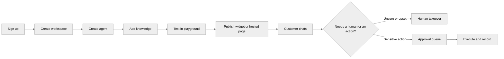
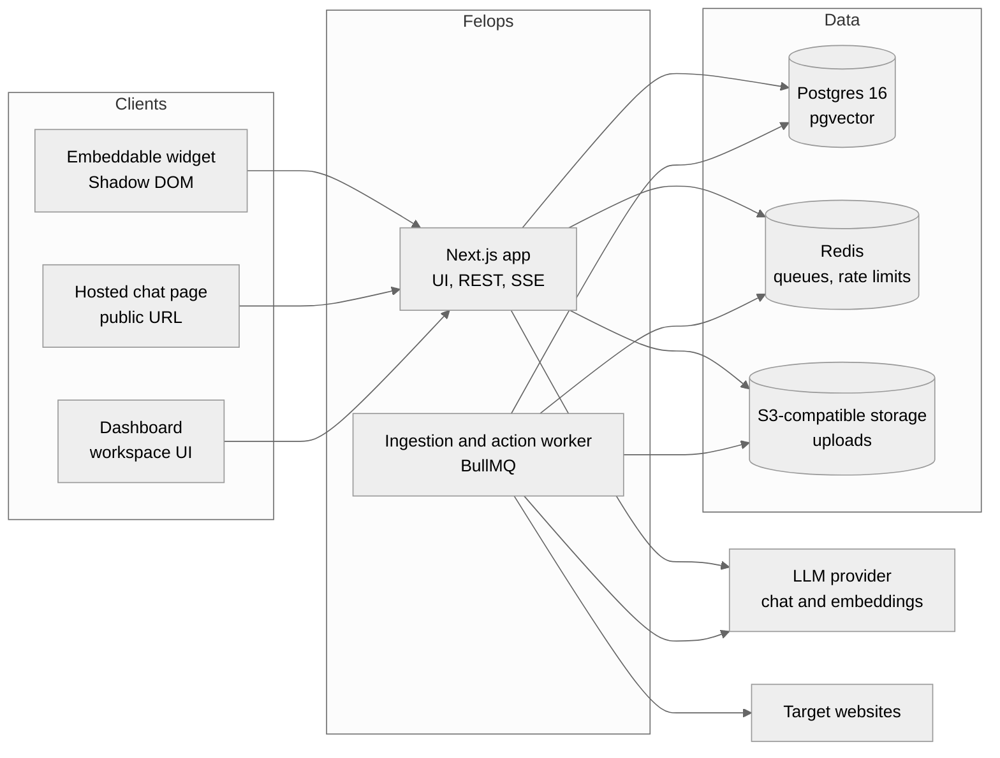
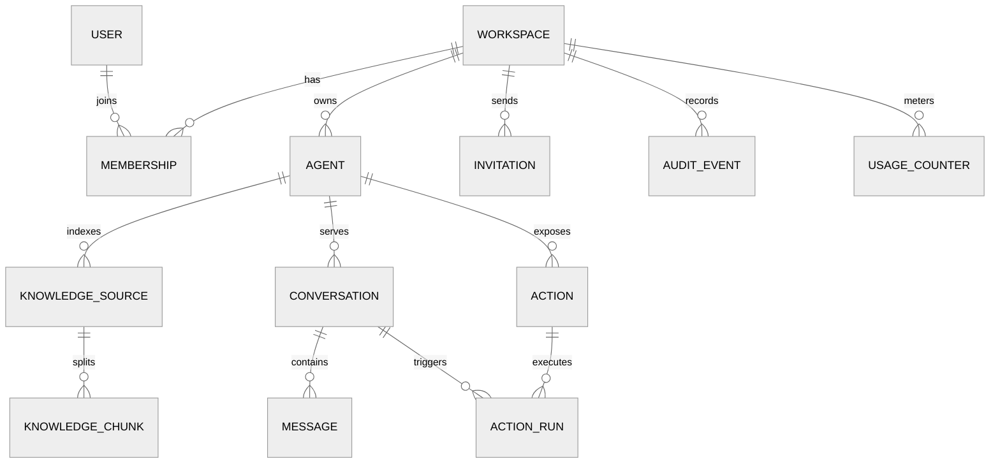
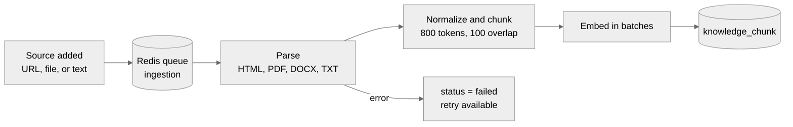
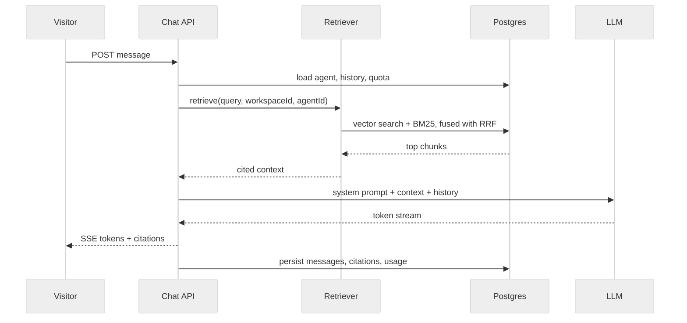
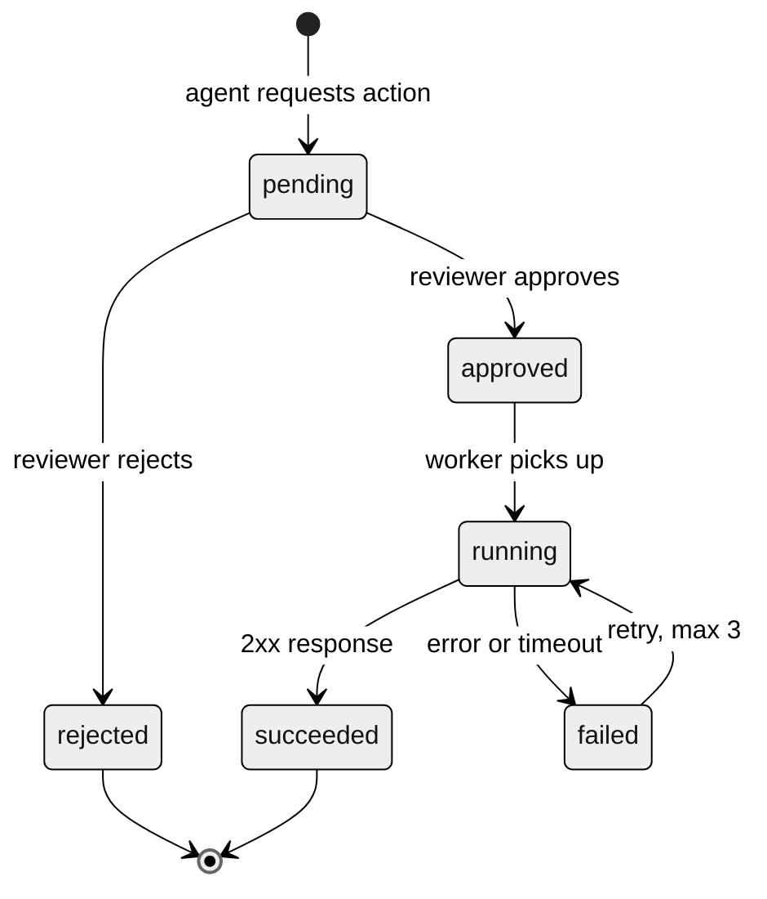

# Felops MVP — Scope and Architecture

**Status:** Decided  
**Date:** 2026-10-30  
**Source material:** `felops-prototype.html` (34 screens)  
**Audience:** Graduation project team, implementation agents

---

## 1. The decision

Felops is an **Arabic-first AI support agent for Egyptian small businesses**.

A business owner adds its own content — website pages, PDFs, a FAQ — and gets an agent that answers customers in Arabic or English, cites where the answer came from, hands the conversation to a human when it is unsure, and asks for approval before it changes anything in the business's systems.

The MVP proves one loop end to end:

> sign up → create workspace → create agent → add knowledge → test → embed → customer chats → human takes over or approves an action → activity is recorded.

That loop is the product. Everything else in the prototype is deferred.

### What we deliberately cut

| Prototype | MVP | Why |
|---|---|---|
| 34 screens | 13 screens (including the public chat page) | A graduation project needs depth in the core loop, not breadth |
| 7-step agent wizard | 3 steps, then tabs | Chatbase's advantage is time-to-first-value; seven steps is friction |
| Salesforce, Gmail, QuickBooks, Slack, HubSpot, Zendesk | One generic HTTP action | OAuth integrations are integration plumbing, not the learning goal |
| Model picker (GPT, Gemini, Claude, DeepSeek) | One configurable default + fallback | Provider abstraction stays; the picker adds UI, not capability |
| Custom roles and 22 permissions | 3 built-in roles | RBAC is present; role editing is not the differentiator |
| Billing checkout, invoices, cards | Plan quotas only | Payment integration is a Phase 2 concern |
| WhatsApp channel | Phase 2 (Twilio sandbox) | High value for Egypt, but Meta verification is a schedule risk |
| Docs site, notifications, analytics charts | Cut | Not needed to prove the loop |

---

## 2. Target user and job

**Primary user:** the owner or operations manager of an Egyptian SMB with 10–100 employees that sells through Instagram, WhatsApp, a website, or a physical store.

Typical profile:

- 200–3,000 customer questions per month.
- Answers are repetitive: shipping, returns, prices, availability, order status.
- Support is done by 1–3 people on WhatsApp, often after hours.
- No engineering team. No desire to learn a prompt framework.
- Content exists but is scattered across a website, PDFs, and staff knowledge.

**Job to be done:**

> "When a customer asks a question in Arabic, I want a correct answer from my own information, in seconds, without hiring another person — and I want a human to stay in control of refunds and account changes."

**Not the v1 user:** enterprises, agencies managing dozens of clients, developers building custom agents. The architecture leaves room for them; the product does not target them yet.

---

## 3. Positioning and differentiation

**One line:**  
*The Arabic-first support agent that can act — with your approval.*

Chatbase and similar tools are excellent at the English-first, website-first, answer-only case. Felops is not a clone. It narrows to three things they do not combine well:

### Pillar 1 — Arabic that actually works

- Egyptian customers write in MSA, Egyptian Arabic, and Franco-Arabic ("3ayez a3raf el shipping").
- The retrieval layer normalizes Arabic (alef variants, ya/alef maqsura, ta marbuta, diacritics, tatweel, Arabic-Indic digits) for lexical search while keeping the original text for display and embeddings.
- Answers match the customer's language and dialect register.
- Every answer carries citations, so a wrong answer is diagnosable instead of mysterious.
- **How the MVP proves it:** a 50-question Egyptian Arabic evaluation set with recall@5 and grounded-answer scoring (stretch task, but the harness is designed in from day one).

### Pillar 2 — Safe action-taking

- The agent can call a real HTTP action (create a ticket, check an order, send a refund request) but **sensitive actions pause in an approval queue**.
- Every run has a visible trace: who requested it, what parameters, who approved, what the system returned.
- This is the trust feature that turns "chatbot" into "agent". It is also the most interesting engineering surface in the project.
- **How the MVP proves it:** a refund request triggers a pending action, an admin approves it, the execution is recorded in the conversation and the audit log.

### Pillar 3 — Egypt-native distribution and pricing

- **Hosted chat page** first, because many SMBs do not have a website worth embedding into.
- **Widget** second, for those who do.
- **WhatsApp** is the Phase 2 channel; conversations already carry a `channel` field, so adding it is a webhook and a sender, not a schema rewrite.
- Pricing in EGP with a free tier, not USD-only. Payment via Paymob in Phase 2.
- **How the MVP proves it:** a hosted page that works on a phone, in Arabic, with RTL, and an embed snippet that a non-technical owner can paste.

### Competitive frame

| | Chatbase-style tools | Felops MVP |
|---|---|---|
| Primary language | English-first | Arabic-first, dialect-aware |
| Primary surface | Website widget | Hosted page + widget, WhatsApp-ready |
| Actions | Limited / no approval layer | HTTP actions with human approval |
| Trust artifact | Conversation log | Conversation log + execution trace + audit |
| Price anchor | USD subscription | EGP plans, free tier |

---

## 4. MVP scope

### 4.1 In scope

| Module | Included in v1 | Acceptance signal |
|---|---|---|
| **Auth** | Email/password, Google OAuth, email verification, session management | A new user can sign up, verify, and land in onboarding |
| **Workspace** | Create workspace, slug, owner membership, workspace switcher when a user belongs to more than one | Slug is unique; non-members get 403 on every workspace route |
| **Team** | Invite by email link, owner/admin/member roles, remove member | Invite is single-use and expires; only owner/admin can invite |
| **Agent** | Create, edit, activate, pause, delete. Instructions: role, language, constraints, response format. Greeting. | Cannot activate without a ready knowledge source that has at least one chunk |
| **Knowledge** | Website crawl (same origin, max 25 pages), PDF, DOCX, TXT, raw text. Status, retry, delete, reindex. | Ingestion completes in under 3 minutes for a 25-page site; failures show a retry action |
| **Chat** | Streaming answers, citations, conversation history, language matching, refusal when evidence is weak | Every grounded answer cites at least one source; low-confidence queries return a safe fallback |
| **Channels** | Embeddable widget with origin allowlist, hosted chat page, public API key | Widget works on an allowed origin and is rejected elsewhere; hosted page renders in Arabic RTL |
| **Inbox** | Conversation list with filters, conversation detail, execution trace, human takeover, close | Taking over stops automatic replies for that conversation |
| **Actions** | Generic HTTP action, JSON parameter schema, optional approval, encrypted headers, timeout, retries, SSRF protection | Approval state machine rejects invalid transitions; duplicate clicks do not execute twice |
| **Approvals** | Pending queue, detail, approve, reject, history, audit event | Only owner/admin can approve; every decision is audited |
| **Dashboard** | Active agents, conversations (24h), pending approvals, connected knowledge, recent activity, needs attention | Numbers match the underlying tables |
| **Plans** | Free/Starter quotas for messages and knowledge sources; upgrade request | Quota exceeded returns a clear 429, not a crash |
| **Ops** | Structured logs, health endpoint, seed script, Docker deploy, E2E happy path | One command brings up local infra; one script seeds a demo tenant |

### 4.2 Explicitly out of scope

- WhatsApp Business API, Meta verification, template messages. **Phase 2:** Twilio WhatsApp sandbox.
- OAuth integrations (Salesforce, Gmail, QuickBooks, Slack, HubSpot, Zendesk).
- Custom roles, fine-grained permissions, SSO, SCIM.
- Payment gateway, invoices, dunning. **Phase 2:** Paymob.
- Multi-agent routing, agent teams, supervisor agents.
- Analytics charts beyond the four dashboard counters.
- Model picker UI. The model is configured by environment and can be changed per agent in the database.
- Notifications center, documentation site, in-app onboarding tour.
- White-labeling, custom domains, mobile apps.

### 4.3 Plans

| Plan | Price | Agents | Messages / month | Knowledge sources |
|---|---|---|---|---|
| Free | 0 EGP | 1 | 100 | 5 |
| Starter | 750 EGP | 3 | 2,000 | 25 |
| Growth | 2,500 EGP | 10 | 10,000 | 100 |

The numbers exist to exercise quota enforcement. No checkout in v1.

---

## 5. The simplified user journey



### 5.1 Screen map: 34 → 13

| # | MVP screen | Replaces prototype screens |
|---|---|---|
| S1 | Sign in / sign up | 01, 02, 03 |
| S2 | Create workspace | 04 |
| S3 | Dashboard | 05 |
| S4 | Agents list | 06 |
| S5 | Agent builder (Basics → Knowledge → Publish) | 07–13 |
| S6 | Agent overview | 14 |
| S7 | Knowledge tab | 24 |
| S8 | Playground (panel) | New; replaces the missing test step |
| S9 | Conversations list | 15 |
| S10 | Conversation detail | 16 |
| S11 | Actions and approvals | 17, 18, 21, 22 |
| S12 | Settings: workspace, members, plan | 28, 29, 32 |
| S13 | Public hosted chat page | 25 (hosted page link) |

Cut without replacement: Integrations pages (19, 20), Instructions/Channels/Model tabs (23, 25, 26), Documentation (27), Custom roles (30, 31), Notifications (33), Account menu (34).

### 5.2 Demo script (the graduation demo)

1. Sign in as **Maya**, owner of **Cairo Threads**, a fictional clothing store.
2. Create the agent **"Support"** with Arabic and English instructions.
3. Add `cairothreads.example` (crawled), `returns-policy.pdf`, and a FAQ snippet.
4. Ask in the playground: **"الشحن بياخد كام يوم؟"** — answer streams with a citation.
5. Ask: **"عايزة أرجّع الأوردر"** — the agent explains the policy and proposes a refund action.
6. Open the approval queue, inspect the parameters, approve.
7. Open the conversation: the execution trace shows the action, the approver, and the result.
8. Take over the conversation as a human; send a reply.
9. Open the hosted page on a phone; show RTL layout and the Arabic greeting.
10. Show the dashboard counters and the audit trail.

---

## 6. Architecture

### 6.1 Principles

1. **Modular monolith, not microservices.** One Next.js deployable plus one worker. The domain is split into packages with explicit interfaces, not network hops.
2. **Synchronous for the user, asynchronous for the machine.** Chat streams in a request. Ingestion and action execution run in a worker with retries.
3. **Tenant scoping is not optional.** Every repository function takes `workspaceId` first. Cross-tenant reads are a security bug, not an edge case.
4. **Ports and adapters for the volatile parts.** LLM, storage, and email sit behind small interfaces. Swapping the chat provider is a one-file adapter change, not a refactor.
5. **The database is the source of truth.** Redis holds queues and rate limits only. Losing Redis must not lose a conversation or a knowledge source.
6. **No premature abstraction.** One HTTP action type beats a plugin system. A `channel` column and a webhook beat a channel marketplace.

### 6.2 Container diagram



**Why this shape:** it is one deployable plus one background process. A student can run it with `docker compose up` and reason about the whole system in one sitting.

### 6.3 Repository layout

```text
felops/
├── apps/
│   ├── web/                 Next.js App Router: dashboard, API, hosted page
│   ├── worker/              BullMQ consumers: ingest, execute action
│   └── widget/              Vite + Preact embed, built to web/public/widget.js
├── packages/
│   ├── db/                  Drizzle schema, migrations, tenant-scoped repositories
│   ├── core/                Domain services: agents, knowledge, chat, actions, billing
│   ├── ai/                  Chunking, Arabic normalization, embeddings, retrieval, prompts
│   └── config/              Zod-validated environment and shared constants
├── docker-compose.yml       Postgres + pgvector, Redis, MinIO
├── turbo.json
└── pnpm-workspace.yaml
```

**Dependency rule:** `apps → core → db` and `core → ai`. `core` never imports Next.js, React, or `next/headers`. This is what makes the domain testable without a browser.

### 6.4 Data model



| Table | Purpose | Key columns |
|---|---|---|
| `user`, `session`, `account`, `verification` | Better Auth tables, generated by the CLI | standard Better Auth columns |
| `workspace` | Tenant boundary | `id`, `name`, `slug`, `plan` |
| `membership` | User-to-workspace role | `user_id`, `workspace_id`, `role` (`owner`/`admin`/`member`) |
| `invitation` | Single-use email invite | `workspace_id`, `email`, `role`, `token`, `expires_at`, `accepted_at` |
| `agent` | One support agent | `workspace_id`, `name`, `slug`, `status`, `instructions jsonb`, `greeting`, `language`, `public_key`, `allowed_origins` |
| `knowledge_source` | One URL, file, or snippet | `agent_id`, `type`, `title`, `url`, `storage_key`, `raw_text`, `status`, `error`, `chunk_count` |
| `knowledge_chunk` | Retrieval unit | `agent_id`, `source_id`, `content`, `content_normalized`, `embedding vector(1536)`, `tsv tsvector`, `token_count` |
| `conversation` | A customer thread | `agent_id`, `channel`, `visitor_id`, `status`, `assigned_to`, `last_message_at` |
| `message` | One turn | `conversation_id`, `role`, `author_type`, `content`, `citations jsonb`, `model`, `tokens_in`, `tokens_out`, `latency_ms` |
| `action` | An HTTP capability | `agent_id`, `name`, `description`, `method`, `url_template`, `headers_encrypted`, `body_template`, `parameters jsonb`, `approval_required` |
| `action_run` | One execution attempt | `action_id`, `conversation_id`, `status`, `args`, `request`, `response`, `approved_by`, `idempotency_key` |
| `audit_event` | Immutable activity record | `workspace_id`, `actor`, `type`, `target`, `data jsonb` |
| `usage_counter` | Monthly quota meter | `workspace_id`, `period`, `messages`, `ingestions` |

**Indexes that matter:** HNSW on `knowledge_chunk.embedding`, GIN on `knowledge_chunk.tsv`, B-tree on every `workspace_id`, and a composite index on `(agent_id, status)` for conversations.

### 6.5 Ingestion pipeline



Rules:

- A crawl stays on the source origin, respects `robots.txt`, caps at 25 pages, 10 seconds per page, and 5 MB per response.
- Files are capped at 10 MB and stored in object storage before parsing.
- Chunks store the original text for display and a normalized copy for lexical search.
- Reindexing deletes the source's old chunks in the same transaction that inserts the new ones.
- The worker sets `processing` before work and always writes a terminal status, even on failure.

### 6.6 Chat and retrieval



Retrieval details:

- Hybrid search: pgvector cosine similarity and Postgres full-text search, fused with Reciprocal Rank Fusion (`k = 60`).
- Normalized Arabic text feeds the lexical side; the original text feeds the vector side.
- Default top-k: 20 candidates → 6 context chunks.
- If the best fused score is below the configured floor, the agent returns the fallback sentence instead of guessing.
- Retrieved content is wrapped in `<source id="n">` tags and the prompt treats it as data, never as instructions.
- Citations are persisted as `[{ index, sourceId, title, snippet }]`.

### 6.7 Action and approval flow



Rules:

- Actions without `approval_required` go straight to `approved → running`.
- Only `owner` and `admin` can approve or reject.
- The request is built from a URL template and a JSON body template with `{{parameter}}` substitution; headers are encrypted at rest.
- The executor blocks private IP ranges, link-local addresses, metadata endpoints, redirects to those ranges, and non-HTTP schemes.
- Every transition writes an `audit_event`.
- The idempotency key is `action_run.id`; a repeated approval returns the existing run, never a second execution.

### 6.8 Stack decisions

| Layer | Choice | Why | Rejected alternative |
|---|---|---|---|
| Web | Next.js App Router + TypeScript | One deployable for UI, REST, SSE; streaming is first-class | Separate SPA + API (more moving parts) |
| UI | Tailwind CSS + shadcn/ui | Matches the prototype's restrained look; accessible primitives | Hand-rolled component library |
| Database | Postgres 16 + pgvector | One datastore for relational data, vectors, and full-text search | Pinecone/Weaviate (extra service, extra cost) |
| ORM | Drizzle | Typed SQL, readable migrations, no hidden queries | Prisma (less SQL transparency for this project) |
| Auth | Better Auth | Self-hosted sessions, email/password and Google, no per-MAU cost | Clerk (cost, lock-in), Auth.js (weaker org model) |
| Queue | BullMQ + Redis | Durable jobs, retries, progress, simple local setup | Database polling (fine, but weaker retry semantics) |
| LLM | Vercel AI SDK behind one adapter; OpenAI for v1 | Streaming and tool calls without provider sprawl; swapping providers is a one-file change | Direct SDK calls scattered across routes |
| Embeddings | `text-embedding-3-small` (1536 dims) | Multilingual, cheap, good Arabic coverage | Local model (ops burden for a student) |
| Widget | Vite + Preact + Shadow DOM | Tiny bundle, style isolation, no host-page conflicts | React widget (too heavy) |
| Tests | Vitest + Playwright | Fast unit tests, one real browser E2E | Jest (slower, more config) |
| Deploy | Neon Postgres + Railway (web + worker + Redis) | Cheap, simple, supports long-running workers | Vercel-only (no worker), Kubernetes (overkill) |

### 6.9 Multi-tenancy and security

- Every table that belongs to a tenant carries `workspace_id`, including `knowledge_chunk` and `message`. Denormalization is intentional: it makes scoping and indexes simple.
- Repository functions are the only database entry point. Their first parameter is always `workspaceId`.
- Route handlers resolve the session, then call `requireWorkspaceMember(slug)`. A route that forgets this is a bug caught by the integration tests.
- Public endpoints use an agent `public_key`, an origin allowlist, and a rate limit. They never expose workspace IDs, member data, or secrets.
- Uploaded files are served through signed URLs, never public bucket URLs.
- Action headers are encrypted with AES-256-GCM using a key from the environment.
- Prompt injection is treated as a data-handling problem: retrieved text is delimited, the system prompt forbids following instructions found inside sources, and actions still require approval.
- Optional defense in depth: Postgres row-level security. Not required for v1 because the repository layer enforces scoping, but the schema is compatible.

### 6.10 Observability and failure behavior

- Structured JSON logs with `requestId`, `workspaceId`, `agentId`, `conversationId`, and `durationMs`.
- A `/api/health` endpoint checks Postgres and Redis.
- Ingestion and action jobs retry with exponential backoff and end in a terminal failed state with a human-readable error.
- Chat persists the user message before streaming and the assistant message in a `finally` block, so a client disconnect does not lose the turn.
- Every LLM call records model, token counts, and latency on the message or run.

---

## 7. Milestones

Assumes one developer, 15–20 hours per week, ten weeks. If the schedule is part-time, add two weeks of buffer; the demo depends on M2 and M5, not on M6 polish.

| Week | Milestone | Exit criteria | Demo |
|---|---|---|---|
| 1 | **M0 — Foundations** | Monorepo runs; Postgres and Redis up; schema migrated; auth and workspace creation work | Sign up, create workspace |
| 2 | **M1 — Agent builder** | Create, edit, activate, pause, delete an agent; 3-step builder shell | Draft an agent |
| 3–5 | **M2 — Knowledge and RAG** | Crawl, upload, chunk, embed, hybrid retrieve, stream cited answers in the playground | Ask an Arabic question, get a cited answer |
| 6 | **M3 — Channels** | Widget on an allowed origin; hosted page in Arabic RTL; public API key | Paste snippet, chat from a phone |
| 7 | **M4 — Inbox and takeover** | Conversation list, detail, trace, human takeover, close | Take over a live conversation |
| 8–9 | **M5 — Actions and approvals** | HTTP action, approval queue, execution, audit | Refund request approved and recorded |
| 10 | **M6 — Hardening and demo** | Quotas, rate limits, seed script, E2E, deploy, demo rehearsal | Full loop in under 10 minutes |

**Stretch, only after M6:** Twilio WhatsApp sandbox, Arabic evaluation harness, Paymob checkout.

---

## 8. Evaluation criteria

### Functional acceptance

- A new user completes sign-up → workspace → agent → first cited answer in under 10 minutes without documentation.
- A 25-page site ingests in under 3 minutes and produces at least one retrievable chunk per page.
- The widget is rejected on a non-allowlisted origin.
- A member cannot approve an action; an admin can.
- A repeated approval does not execute the action twice.
- A conversation taken over by a human receives no further automatic replies.
- No integration test can read another workspace's agent, source, conversation, or run.

### Quality metrics

| Metric | Target | How measured |
|---|---|---|
| Retrieval recall@5 | ≥ 80% | 50-question Egyptian Arabic set with known source pages |
| Grounded answer rate | ≥ 90% | LLM judge or manual review of 50 answers |
| Unsupported-answer rate | < 5% | Answers with claims absent from retrieved context |
| p95 time to first token | < 2.5 s | Server timing on the chat route |
| Cross-tenant leaks | 0 | Integration test suite |
| Setup time (usability test) | < 10 min | 5 SMB owners, think-aloud |

### What the graduation committee should see

1. A working multi-tenant SaaS, not a local demo.
2. A real RAG pipeline with Arabic-specific handling and citations.
3. A human-in-the-loop action system with a state machine and audit trail.
4. Tests that prove tenant isolation and approval safety.
5. A clear rationale for every cut.

---

## 9. Risks and mitigations

| Risk | Likelihood | Impact | Mitigation |
|---|---|---|---|
| Arabic retrieval quality is weak | Medium | High | Hybrid search, normalization, 50-question eval set, optional rerank in Phase 2 |
| WhatsApp verification delays the demo | High | Medium | Keep WhatsApp out of v1; Twilio sandbox only as stretch |
| LLM cost during testing | Medium | Medium | Free-tier models, small eval set, response caching, quotas |
| Scope creep from the prototype | High | High | The cut list in §4.2 is a contract; new ideas go to Phase 2 |
| One developer, ten weeks | High | High | Milestones ship independently; M2 and M5 are the only hard dependencies for the demo |
| Prompt injection through crawled pages | Medium | High | Delimited sources, instruction hierarchy, approval gate, test fixture |
| Action executor abused as SSRF proxy | Low | High | DNS resolution checks, private-range block, redirect re-validation, timeout |

---

## 10. Assumptions to confirm

These do not block implementation; they are defaults chosen to keep the plan decisive.

1. **Stack:** TypeScript across web, worker, and widget. If the team is already fluent in Python, the architecture survives, but this plan's file paths and interfaces assume TypeScript.
2. **Deployment:** Neon + Railway. A single VPS with Docker Compose is an acceptable fallback.
3. **LLM access:** an OpenAI-compatible key is available. The provider adapter allows swapping to another vendor.
4. **Team size:** one developer. Two developers can parallelize M2 (RAG) and M3 (channels) after M1.
5. **Language:** product UI is English with Arabic customer-facing surfaces; full Arabic dashboard localization is Phase 2.
6. **Legal:** the demo uses fictional business data. No real customer data is ingested.

---

## 11. What "done" means

The MVP is done when a stranger can:

1. Sign up and create a workspace.
2. Create an agent, add three sources, and get a cited Arabic answer.
3. Publish a hosted page and embed the widget.
4. Watch a conversation, take it over, and approve an action.
5. See the action and the approval in the audit trail.

...without the developer touching the database, the terminal, or the code.
